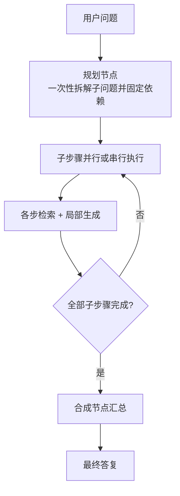
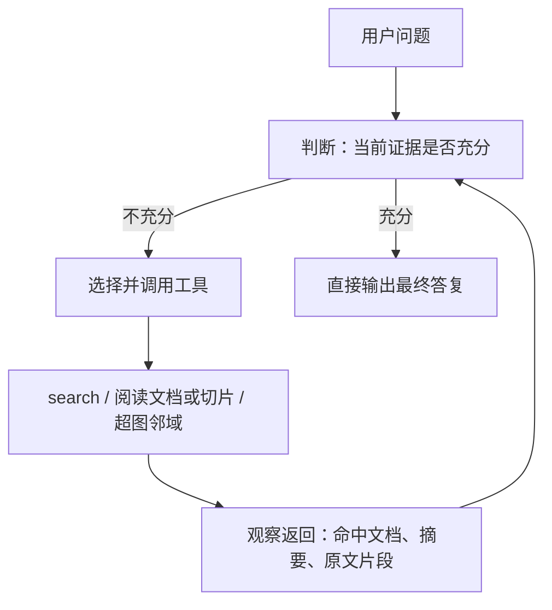
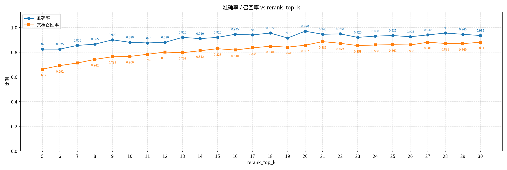
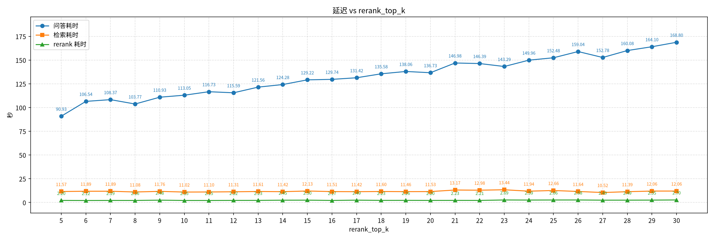

# 化工超图检索增强系统工作汇报

**汇报周期：** 2026 年 8 月 26 日 — 9 月 8 日
**系统名称：** Chemical-Graph-RAG
**回答模型 / 裁判模型：** qwen3.6-27b
**对照基线：** Agent 规划图模式、无检索纯大模型

---

## 一、工作概述

本周期工作以问答链路升级为主，辅以评测体系重构、检索稳定性治理及专利/安全数据说明书（MSDS）入库。核心进展如下。

**（一）Agentic 问答模式上线（重点）**

将原有「一次规划、按依赖执行」的 Agent 模式，升级为基于工具调用的 Agentic 循环：模型在同一会话中交替进行判断、调用检索/阅读工具、根据返回结果再决策，直至证据充分后给出最终答复。可调用工具包括混合检索、关键词检索、实体节点检索、正文块检索、文档全文阅读、切片阅读及超图邻域查询。检索宽度、重排序截断及关键词抽取与 Agent 模式配置相互独立。同期完成关键词黏连修复、检索收束策略（含极小证据集）及切片阅读工具，并对外提供 HTTP 服务接口。

**（二）评测体系重构**

废弃既有评测流水线，按三类任务重建：库内自生成多跳试题（含专利文档）、建筑涂料外部试题、专利配方五类试题。同一题目并行采集 Agentic 答复与无检索纯模型答复，由裁判模型成对评判并汇总准确率、召回率及时延。

**（三）检索与运行侧治理**

关键词通路限定于技术资料正文，抑制短词与过泛词；完善同源切片族扩展与检索范围约束；预计算结构支持内存常驻并修复并发锁。对 Agent 模式完成重排序截断规模（top-k = 5–30）敏感性分析。

**（四）语料建设**

专利文档已完成识别、构图与向量化，并纳入上述评测。MSDS 大批量识别入库仍在进行，后段摘要与向量化尚未启动（见第四节）。

**（五）图谱必要性验证**

以 200 道分层抽样试题，将超图系统与四家主流大模型闭卷作答对照，检验参数记忆能否替代本地知识库。结论与分题型归因见第五章。

---

## 二、问答架构对比：Agentic 工具循环与 Agent 规划图

### 2.1 Agentic 自主检索作答机制

本期 Agentic 模式参考开源 Grok Build 的工具调用式作答：大模型在同一会话中自主决定「是否还要检索、调用哪一类工具、查询如何改写」，系统不预先规定检索次数与步骤。优先走函数调用协议；接口不支持时自动降级为结构化动作描述。每一轮先判断现有上下文是否足以核验要点；不足则调用工具，将返回纳入会话后再判断。轮次用尽时强制依据已核实证据作答，不再检索。牌号、CAS、出厂指标与配方必须以工具结果为准，不得用行业常识填补商品实测值。

检索命中仅返回短摘要与文档/切片标识。长对话中较早的工具原文会被压缩，已核实字段需写入**证据槽**（主体、字段、数值、单位及来源标识；同主体同字段后写覆盖）。最终作答以证据槽及仍完整的最近若干轮结果为准。

**工具及其适用情形如下。**

| 工具         | 作用                                        | 适用情形                                                                            |
| ------------ | ------------------------------------------- | ----------------------------------------------------------------------------------- |
| 多路模式检索 | 按指定通路召回候选，返回摘要与文档/切片标识 | 具体问题用最适合的模式查找                                                          |
| 按id读整篇   | 按阅读顺序取出该文档切片的全部正文块        | 已大致锁定文档，需连续阅读表格、配方或多段上下文                                    |
| 按id找单块   | 只取出一块正文                              | 核对单一数值或规格；长 PDF 在切片边界断开时跳至邻片核对。禁止借此沿邻接关系通读整篇 |
| 图邻域查找   | 返回同一超边/文档上的实体邻居               | 由产品查生产企业、由企业查其它产品等主体跳转                                        |
| 极小证据槽   | 固化已核实的字段与出处                      | 工具结果中一旦抽出可核验事实即写入，避免后续压缩丢失                                |

**检索含四种通路，查询须写成可独立理解的完整问句，禁止堆砌关键词。**

| 通路           | 后端行为                                                          | 适用与约束                                                                                                                         |
| -------------- | ----------------------------------------------------------------- | ---------------------------------------------------------------------------------------------------------------------------------- |
| 关键词精确匹配 | 再抽取牌号、CAS、货号、文件编号等少数值标识，对正文做精确包含匹配 | 已持有具体标识、需锁定技术资料或安全说明书。无标识时不用本通路；相对密度、闪点等常见字段名或连续量亦不宜作为精确匹配词，以免滥召回 |
| 实体节点向量   | 仅在产品、企业、物质等实体节点上检索，再映射回所属文档            | 问「谁生产」「某公司有哪些产品」「某物质是什么」。查询须针对单一主体；多约束筛选不宜走本通路                                       |
| 正文块向量     | 仅对正文块做语义检索                                              | 无强标识、需查找用途、工艺、配方、试验方法等描述性内容                                                                             |
| 混合（默认）   | 正文块向量、节点向量与少数值精确匹配三路并集，再经重排序          | 拿不准通路，或同一问题既含标识又含规格/用途。同一主体的多项约束应写入同一句，不宜拆成多次单条件检索                                |

典型决策顺序：有牌号或专利号则优先关键词通路锁定文档；问归属或产品线则走实体节点；问工艺机理则走正文块；不确定或条件交织则用混合。首轮落空则改写问句或更换通路，而非继续堆词。已锁定文档后，连续多块用整篇阅读，单点核对用单块阅读；涉及企业—产品跳转再用超图邻域。证据充分后停止调用工具，直接自然语言作答。

### 2.2 机制差异

Agent 模式在图编排框架上采用**规划有向无环图（plan DAG）**：进入问答后，模型一次性将多跳问题拆解为检索子步骤并固定依赖关系，随后按图执行检索与局部生成，最后由合成节点汇总。检索策略在规划阶段即被锁定，中间结果难以触发策略回退；即便单跳问题也需走完整编排。

Agentic 模式采用 **TAG 循环**（Think—判断下一步；Act—调用工具；Get—观察工具返回）：不预先生成全图。模型可根据首轮检索质量更换查询语句或检索通路，在锁定牌号或专利号后按需阅读原文，并将多跳问题拆为多次窄查询，而非一次性将全部候选挤入重排序窗口。

### 2.3 处理流程对照（示意图）

以「基体助剂用量 + 两份专利防火等级对比」这类三跳问题为例，两种模式的处理路径如下。

**Agent 模式（规划图，一次规划后按步执行）**



规划完成后，各子步骤共用既定检索宽度与重排序截断。若专利号对应文档未进入窗口，后续合成只能基于不完整证据推断，无法再发起针对性检索。

**Agentic 模式（TAG 工具循环，按观察结果动态决策）**



同一道三跳题上，典型轨迹为：首次按基体与助剂牌号检索 → 再分别以两份专利号检索 → 必要时阅读原文核对等级字段 → 汇总作答。检索次数与查询由模型按缺口补齐，而非由初始规划一次性规定。

### 2.4 能力对照与本期实测

| 维度         | Agent（规划图）                          | Agentic（TAG 循环）                  |
| ------------ | ---------------------------------------- | ------------------------------------ |
| 检索策略     | 规划阶段固化，执行期难以回退             | 依据中间结果更换查询与检索通路       |
| 证据获取     | 依赖单次（或按步）重排序窗口             | 可多次检索，并按需阅读原文或切片     |
| 多跳文档召回 | 随跳数衰减明显                           | 可按跳补检，标准文档更易凑齐         |
| 失败形态     | 窗口缺失关键文档时，合成阶段易作笼统推断 | 主要受工具调用轮次与单路检索质量约束 |

在同一套 200 道库内自生成试题上：Agent 正确率 78.5%、文档召回 62.9%；Agentic 正确率 96.0%、文档召回 84.7%。Agentic 正确而 Agent 错误者 39 题，反向仅 4 题。外部试题上 Agentic 平均时延更高（约 166 秒对比 Agent 约 101 秒），源于平均检索轮次增加。

### 2.5 典型案例：三跳综合问题的答复对照

下列对照取自库内自生成评测中的同一道三跳试题（试题编号 q_3hop_0012）。Agentic 与 Agent（重排序 top-k = 8）分别作答，由同一裁判模型对照标准答案判定。Agentic 判定为正确，Agent 判定为错误；标准文档召回分别为 3/3 与 0/3。Agentic 本轮检索 4 次、对话 4 轮。

**原问题（全文）：**

> 我们计划开发一款用于食品接触表面的高性能不粘涂料，同时该涂料需应用于对施工稳定性要求极高的建筑外墙保温系统（需防止纤维脱落并具备高抗压性）。请基于现有资料分析：1. 在涂料配方中，应选用哪种陶氏（Dow）添加剂以实现不粘性能并符合FDA食品接触标准？其推荐添加量是多少？2. 在保温板制造中，根据北京匀乐科技的专利，用于包裹纤维层以防止脱落并增强抗压的‘硅酸凝胶外壳’是由哪四种主要成分组成的？其质量比范围是多少？3. 若在施工过程中遇到混凝土基材离析问题，巴斯夫（BASF）的哪款粘度改性剂可用于改善浆体稳定性？

**标准答案要点：** 陶氏添加剂为 DOWSIL™ 1-9770 Release Additive，符合 FDA 21 CFR 175.300，添加量为有机硅树脂固体重量的 0.1%–5.0%；硅酸凝胶外壳由水玻璃、水溶性酚醛树脂、硅酸盐水泥和清水组成，权利要求书质量比范围为 4—8 : 10—8 : 10—5 : 5—6；巴斯夫粘度改性剂为 RHEOPLUS® 420。

**Agentic 答复（裁判：正确）。** 三问分别给出 DOWSIL™ 1-9770（0.1%–5.0%，FDA 21 CFR 175.300）、专利 CN 109868909 A 四种成分及权利要求书配比、RHEOPLUS® 420。裁判意见：型号、添加量、成分及配比均与参考文档及标准答案一致。

**Agent 答复（裁判：错误）。** 第一问推荐 DOWSIL™ 402LS Additive（添加量 ≥0.5%），并称现有资料未明确其 FDA 合规；第二问写明「现有检索资料中未收录北京匀乐科技关于硅酸凝胶外壳的具体专利数据」，改用行业通用溶胶–凝胶包覆体系估算配比；第三问推荐减水剂 MasterGlenium® C333，并称资料中未提供专用粘度改性剂。裁判意见：未依据参考文档作答，陶氏型号错误，且声称未找到匀乐科技专利，完全偏离标准答案。

该题三问分别绑定陶氏技术资料、匀乐科技专利与巴斯夫粘度改性剂文档。规划图一次检索未命中任一标准文档，合成阶段用相近牌号与行业通性填补；工具循环按厂商与专利线索分次检索，三篇标准文档均进入上下文，从而给出可核验的型号与配比。

---

## 三、评测结果

评判约定：库内自生成试题与专利试题采用二分类正确率，并统计标准文档召回；外部试题采用 0–3 分，严格正确率为「正确」占已评判题数，宽松正确率为「正确 + 部分正确」占比。裁判为成对比较。

### 3.1 库内自生成试题（200 题，含专利，同一题集）

| 指标                     |          Agentic | Agent（重排序 top-k = 8） |  无检索纯模型 |
| ------------------------ | ---------------: | ------------------------: | ------------: |
| 正确率                   | 96.0%（192/200） |          78.5%（157/200） | 约 10%–11.5% |
| 文档召回                 |            84.7% |                     62.9% |            — |
| 一跳 / 二跳 / 三跳正确率 | 100% / 94% / 90% |           80% / 78% / 76% |            — |
| 相对纯模型独对题数       |              173 |                       136 |            — |
| 成对胜出                 |              192 |                       170 |        6 / 13 |
| 平均作答时延             |          46.3 秒 |                   77.7 秒 |  约 30–42 秒 |

标准文档全部命中时：Agentic 145 正 1 误，Agent 97 正 0 误。正确率上限主要由召回决定；两套评测中纯模型正确率略有波动，均约一成。

### 3.2 建筑涂料外部试题（1 177 题，同一试题表）

| 指标               |              Agentic |              Agent | 无检索纯模型（两套评测各自对照） |
| ------------------ | -------------------: | -----------------: | -------------------------------: |
| 严格正确率         | 86.2%（1 014/1 176） | 80.2%（944/1 177） |                    61.2% / 60.7% |
| 部分正确           |                  139 |                207 |                        416 / 447 |
| 错误               |                   23 |                 26 |                          40 / 16 |
| 宽松正确率         |               98.04% |              97.8% |                           约 98% |
| 均分（0–3）       |                 2.65 |               2.61 |                      1.77 / 2.03 |
| 相对纯模型成对胜出 |         950（80.8%） |      870（约 74%） |                               — |
| 平均作答时延       |             165.6 秒 |           101.5 秒 |                         约 67 秒 |

三套系统的宽松正确率均接近饱和，差异集中在「要点是否完整、数值是否可核验」。Agentic 将大量「部分正确」提升为「正确」；相对纯模型的均分差约 0.88，Agent 同期约为 0.59。

### 3.3 专利配方试题（99 题）

该集仅对照 Agentic 与无检索纯模型，题型为产品→配方、应用→配方、配方优化、成分→配方、成分互换，各约 20 题。

| 指标     |        Agentic | 无检索纯模型 |
| -------- | -------------: | -----------: |
| 正确率   | 91.9%（91/99） | 4.0%（4/99） |
| 文档召回 |          78.8% |           — |
| 成对胜出 |             90 |  4（平局 5） |
| 独对题数 |             88 |            1 |

分题型正确率（Agentic / 纯模型）：配方优化 100% / 5%；成分→配方 100% / 5%；产品→配方 94.7% / 5.3%；成分互换 85% / 5%；应用→配方 80% / 0%。应用→配方时延最高（平均约 11 分钟），实体节点检索在百万级节点规模下开销显著。专利类事实几乎无法由纯模型凭参数记忆给出。

### 3.4 topk的敏感性分析

在 Agent 模式下，对同一套 200 道复杂试题将重排序截断规模 top-k 自 5 扫描至 30，观察正确率、文档召回与作答时延。对应曲线如下。

**图 1　正确率与文档召回随截断规模的变化**



**图 2　时延随截断规模的变化**



| 截断规模 k | 正确率 | 文档召回 | 平均作答时延 |
| ---------: | -----: | -------: | -----------: |
|          5 |  82.5% |    66.3% |      90.9 秒 |
|          6 |  82.5% |    69.2% |     106.5 秒 |
|          7 |  85.5% |    71.3% |     108.4 秒 |
|          8 |  86.5% |    74.2% |     103.8 秒 |
|          9 |  90.0% |    76.3% |     110.9 秒 |
|         10 |  88.0% |    76.6% |     113.0 秒 |
|         11 |  87.5% |    78.3% |     116.7 秒 |
|         12 |  88.0% |    80.1% |     115.6 秒 |
|         13 |  92.0% |    79.6% |     121.6 秒 |
|         14 |  91.0% |    81.2% |     124.3 秒 |
|         15 |  92.0% |    82.8% |     129.2 秒 |
|         16 |  94.5% |    81.8% |     129.7 秒 |
|         17 |  94.0% |    83.5% |     131.4 秒 |
|         18 |  95.5% |    84.8% |     135.6 秒 |
|         19 |  91.5% |    84.1% |     138.1 秒 |
|         20 |  97.0% |    85.7% |     136.7 秒 |
|         21 |  94.5% |    88.6% |     147.0 秒 |
|        22* |  94.8% |    87.2% |     146.4 秒 |
|         23 |  92.0% |    85.3% |     143.3 秒 |
|         24 |  93.0% |    85.8% |     150.0 秒 |
|         25 |  93.5% |    86.1% |     152.5 秒 |
|         26 |  92.5% |    85.8% |     159.0 秒 |
|         27 |  94.0% |    88.1% |     152.8 秒 |
|         28 |  95.5% |    87.1% |     160.1 秒 |
|         29 |  94.5% |    86.9% |     164.1 秒 |
|         30 |  93.5% |    88.1% |     168.8 秒 |

扫描中 k = 8 正确率为 86.5%；与 Agentic 对照所用的既有 Agent 评测为 78.5%，对应更早的检索配置与库规模，对照表仍采用该既有结果。扫描表明：在规划图模式下扩大一次性窗口，正确率与召回总体随 k 上升，约在 k = 18–20 见顶（k = 20 正确率 97.0% 为峰值）；继续增大则正确率波动回落，时延持续增加。Agentic 通过多次窄检索达到相近或更高召回，无需将单次截断扩至 20。

趋势概括：k 自 5 增至 20，召回约 66%→86%，正确率 82.5%→97%；k 大于 20 后召回仍略升，正确率回落，作答时延由约 90 秒增至 160 秒以上。

---

## 四、知识库构建进度

截至 2026 年 9 月 8 日，主库规模与阶段状态如下。

| 项目                                       | 数量或状态                                   |
| ------------------------------------------ | -------------------------------------------- |
| 已完成摘要、分块、抽取、构图及向量化的文档 | 48 501 篇                                    |
| 已识别入库、尚未进入摘要分块的文档         | 87 340 篇（以本轮 MSDS 为主）                |
| 文档记录合计                               | 135 841                                      |
| 正文块 / 向量化                            | 377 548 / 全部完成（对应已完结的 4.85 万篇） |
| 实体节点 / 向量化                          | 4 827 583 / 全部完成                         |
| 文档级超边（摘要）                         | 48 501                                       |

本轮对工作目录中约 4.97 万份 PDF（含 MSDS）按每批 500 份识别，共计 100 批。前段大量为已入库技术资料/专利切片，识别被跳过。当前约进行至第 45 批，视觉模型识别仍在运行，偶发超时后自动重试。新插入记录停留在待摘要状态，**摘要、分块、实体抽取、构图与向量化均未启动**。已完成向量化的仍为上一周期技术资料与本期专利；MSDS 须待识别全部落盘后再接入流水线后段。

识别后端方面，本轮 MSDS 由整页多图 VLM 中文转写切换为 PaddleOCR-VL，切片吞吐大约提升 5–10 倍，但入库正文形态与检索适配性明显变差。原 VLM 路径按提示词将表格、限值与字段名译成通顺中文，并写成「产品是……，CAS 号为……」一类可独立理解的句子，便于向量检索与后续问答对齐；OCR 路径则保留版面 HTML（`<table>`、`<div>`、``、LaTeX 壳）及原文英文，字段被拆在单元格里，页眉页脚重复，直接进向量会浪费 token、也难以匹配中文问句。同一任务下的对照如下。OCR 取本轮最新切片 [latest_paddleocr.md](../scripts/outputs/latest_paddleocr.md)（Ashland Aqualon™ CMC 7H3SX8F，第 0–4 页）；该 PDF 未经 VLM 识别，VLM 一侧取库内原路径、同为 SDS 的 Cabot LITX® 93R 炭黑（`6e664b8c3ae977471e7a91a858188447.pdf`）以展示既有转写风格。

**OCR（PaddleOCR-VL，原文+格式代码，内容散乱）：**

```html
<div style="text-align: center;"></div>
Page: 1
<table border=1 style='margin: auto; word-wrap: break-word;'>
  <tr><td>SAFETY DATA SHEET</td><td></td><td>Revision Date: 02/08/2024</td></tr>
  <tr><td>Aqualon $ ^{\text{™}} $ CMC 7H3SX8F Cellulose Gum … 414402</td><td></td><td>Version: 1.3</td></tr>
</table>
Substance / Mixture : Substance
CAS-No. : 9004-32-4
```

**VLM（原多图转写，中文自然语言纯文本）：**

```text
安全数据表
根据 (EU) 第 1907/2006 号法规（REACH）和 (EU) 第 1272/2008 号法规
产品代码：LITX93R
产品名称：LITX® 93R Carbon Black
同义词：炭黑，乌黑
化学名称：炭黑
CAS 号：1333-86-4
重量百分比：100
根据 (EU) 第 1272/2008 号法规 [CLP]，该物质未分类为危险物质。
```

可见：OCR 吞吐更高，但正文为英文碎片并夹杂排版标记；VLM 时延更高，但字段已转写为可检索的中文陈述。后续需在 OCR 结果上完成去标签与「字段: 值」线性化（或对关键切片回退 VLM），否则 MSDS 入库虽快，向量与关键词通路的命中质量将明显低于既有技术资料。

---

## 五、主流大模型闭卷作答与超图系统对照：图谱必要性验证

本节转述同期对照实验（原始分析见 [主流大模型 vs 超图知识图谱系统：图谱必要性验证](主流大模型 vs 超图知识图谱系统：图谱必要性验证.md)）。数据来源为 `report_mainstream_20260901_1942.xlsx`，200 题全部完成评判。实验目的是检验主流大参数模型在**不检索本地库**的条件下，是否已具备足以替代超图知识库的事实覆盖。

### 5.1 实验设置与评分标准

| 项 | 内容 |
| --- | --- |
| 题库 | 200 题，分层抽样（seed = 40）：report_complex 100 题、question1 50 题、question2 50 题 |
| 被评系统 | 超图知识图谱系统（作答取自既有评测报告）；对照模型为 deepseek-v4-pro-0813、qwen3.8-max、glm-5.2、kimi-k2.6，均闭卷作答 |
| 评判 | 每题由裁判模型 qwen3.8-max 对五路作答分别赋 0–3 分并给出排序 |
| 赋分口径 | 3 分：结论可核对（含具体类型、型号、指标或条件）；2 分：方向正确但主对象含糊；1 分：仅常识综述或「视情况而定」；0 分：错误或幻觉 |

### 5.2 总体结果（n = 200）

| 系统 | 均分 | 3 分 | 2 分 | 1 分 | 0 分 | 达标率（≥2 分） |
| --- | ---: | ---: | ---: | ---: | ---: | ---: |
| **超图** | **2.190** | 107 | 42 | 33 | 18 | **74.5%** |
| deepseek-v4-pro-0813 | 1.260 | 1 | 74 | 101 | 24 | 37.5% |
| kimi-k2.6 | 1.205 | 10 | 55 | 101 | 34 | 32.5% |
| qwen3.8-max | 1.185 | 11 | 51 | 102 | 36 | 31.0% |
| glm-5.2 | 1.095 | 7 | 32 | 134 | 27 | 19.5% |

超图满分占比 53.5%，零分占比 9%；在五路排序中列末位 31 次，为最少。四家主流模型达标率均不超过 37.5%，3 分次数显著少于超图。

按知识类型归纳如下。大参数模型**不能替代**本地知识库，但二者在题型上互补。

| 知识类型 | 题量 | 超图 vs 主流最优（满分 3 分） | 判定 |
| --- | ---: | --- | --- |
| 私有产品资料（牌号指标 / TDS） | 约 99 | 2.61 vs 1.34 | 知识库覆盖区，不可替代 |
| 专利方案相关知识 | 21 | 2.71 vs 1.10 | 知识库覆盖区 |
| 公开标准常识（国标指标 / 原材料基础参数） | 约 10 | 0.60 vs 2.20 | 大模型覆盖区，知识库缺口 |
| 通用工程判断（排查诊断 / 业务决策） | 约 50 | 0.83 vs 2.50 | 大模型优势区 |

### 5.3 分问题集归因

**（1）report_complex（100 题）：私有产品资料。** 约 79% 的题干嵌入具体牌号或型号，约 61% 询问指标或参数。题目要求依据给定资料回答出厂指标、适用性或工艺窗口，答案存在于企业私有 TDS、专利或 MSDS，而非公开语料。内部再分层：产品资料类 79 题，超图 2.61、主流最优 1.34，超图 3 分率 73%；题干含「专利 CN …」的 21 题，超图 2.71、主流最优 1.10。

典型可核验事实仅见于源文档：complex_q_1hop_0056 询问 CARBOWAX™ SENTRY™ 聚乙二醇 8000 的 CAS、熔点及 100°C 粘度，标准答案为 CAS 25322-68-3、熔点 55–62°C、粘度 821.7 cSt，四家主流仅一家答对 CAS，粘度估值全部偏离（70–90 cSt、100–300 mPa·s 等）；complex_q_1hop_0024 询问 PLASBLAK® XP6589B 是否适用于汽车内饰 PP 及推荐添加区间（0.5%–4%），主流仅能给出通用经验比例；complex_q_1hop_0026 询问道康宁 1-2577 在 80°C 的固化程序（室温 10 min + 80°C 烘烤 10 min，低温测试前室温保持不少于 6 小时）；complex_q_3hop_0031 同时约束 Bermocoll EM 7000 FQ、AEROXIDE TiO₂ P 25、Nipacide CFX 三个物料，需交叉计算防腐剂质量百分比、判断 pH 4–9 是否覆盖混合体系，并给出 45°C 添加策略；complex_q_1hop_0095 询问专利 CN 102702968 A 甲/乙组份配比及分散转速（2:1；730 rps / 15 min），主流未能复现。该类题目的共同特征是：题干锁定具体产品，答案为可核对的数字、区间或结论。超图得分来自检索与图谱直接给出上述字段。其失误主要来自检索错配或口径错误，例如将 TEGO Foamex 805 N 的适用性判反、将分散剂误推为 Dispersogen PLF 100、添加量按颜料重量计而非研磨料计、专利缓蚀收益点将防锈与附着力混淆。

**（2）report_question1（50 题）：行业知识与标准指标。** 仅约 4% 的题干含产品牌号，题型为技术指标、替代方案、配方改进与认证要求。题干含「技术指标 / 粒径 / pH 是多少」句式的 10 题（耐人工老化、真石漆涂布率、耐碱性、1250 目重钙粒径、矿物油消泡剂 pH、水包水耐沾污性等），超图均分 0.60、主流最优 2.20，其中 7 题超图为 0 分。该类答案来自 GB/T 等公开标准，主流模型可直接作答；超图库以产品资料为主，**未收录标准规范**，检索落到具体产品后易出现口径偏离或答非所问。其余 40 题超图仍领先（2.15 vs 1.93）：替代方案需落到型号与用量（如 question1_Q0429 将 HEC 替换落实到 HEUR/ASE/HPMC 及用量，主流停留在增稠剂大类）；认证类仅超图给出 GREENGUARD/CDPH 路径及合规牌号（question1_Q0704）；选材类如 Q0542、Q0627 亦仅超图列出可核对牌号。该集表明知识库缺口在「标准 / 规范」一层，而非产品资料本身。

**（3）report_question2（50 题）：通用工程判断。** 题干均不含品牌号；约 24% 为排查诊断、约 22% 为清单枚举。出题呈模板化：仓库某涂料分层原因与快速判断（6 题）、市场传闻退货是否跟进改配方（6 题）、投标 / 成本 / BOM 询价（约 5 题）。答案不指向特定资料，而指向排查框架与业务常识。全集超图 1.66，主流最优（deepseek）1.70。仓库分层 6 题超图 0.83、主流最优 2.33，超图无一题列第一；传闻应对 6 题为 1.83 vs 2.50；方案 / 成本 / 投标 5 题为 1.60 vs 2.20。同一模板在正反两例上得分不稳定：Q0184 主张「立即改配方」（0 分），Q0652 则正确给出「不宜盲目跟进，先排查铁离子污染与助剂耐碱性」（3 分）。失误形态包括检索错配（分层题将判断核心落到无关消泡剂 ADDITOL® XW 6569，或引入与分层无关的 UCON/DOWSIL 牌号，遗漏增稠失效、分散不足、细菌降解等主因）以及知识内容错误（氟碳乳液 Tg 给出 −20~10°C 且所引型号多非氟碳乳液）。超图作答平均约 2 352 字，为五路最长（主流约 1 600 字），篇幅未转化为得分。该集是主流模型的优势区：完整排查框架与现场可执行动作属于公开工程常识，而非检索系统的长项。

### 5.4 本节结论

闭卷条件下，主流大模型不能替代本地超图知识库。牌号指标、工艺窗口、专利配比等可核验事实依赖源文档，超图在对应子集上均分显著高于四家对照；国标指标与通用排查框架则是大模型覆盖区，当前库未收录规范层、且在无牌号模板题上存在检索错配。系统定位应为**检索核验与模型推理分工**，而非相互替代。原始数据表与逐题分析见上述链接文档。

---

## 六、结论与后续安排

1. **Agentic 已作为主问答路径。** 相对规划图模式，库内自生成试题正确率由 78.5% 提升至 96.0%，文档召回由 62.9% 提升至 84.7%；外部试题严格正确率由 80.2% 提升至 86.2%。无检索纯模型在库内事实题与专利题上分别约为 10% 与 4%，不具备单独承担该类任务的条件。
2. **收益主要来自按缺口补检，而非单纯扩大单次窗口。** 2.5 节三跳案例中，Agent 标准文档召回为 0，将陶氏助剂误推为 402LS、专利配比改用行业通性估算；Agentic 分次检索命中全部三篇标准文档，型号与配比与源文档一致。敏感性分析亦表明，规划图下将 top-k 提至约 20 才能接近高峰正确率，并显著增加时延。
3. **闭卷主流大模型不能替代本地知识库。** 第五章对照显示：私有产品资料与专利方案上超图均分分别为 2.61 与 2.71，四家主流最优为 1.34 与 1.10；国标常识与通用工程判断上则相反。宜坚持检索核验与模型推理分工，并补齐标准规范类语料。
4. **当前约束。** 外部试题平均时延偏长；专利「应用→配方」在超大规模节点索引上检索开销突出；MSDS 识别未完成，后段构图尚未开始。
5. **后续安排。** 完成 MSDS 识别后接入摘要至向量化；压缩专利场景下实体检索时延；控制 Agentic 平均检索轮次以降低外部试题时延；视需要以当前 Agentic 配置复测第二套外部试题。
